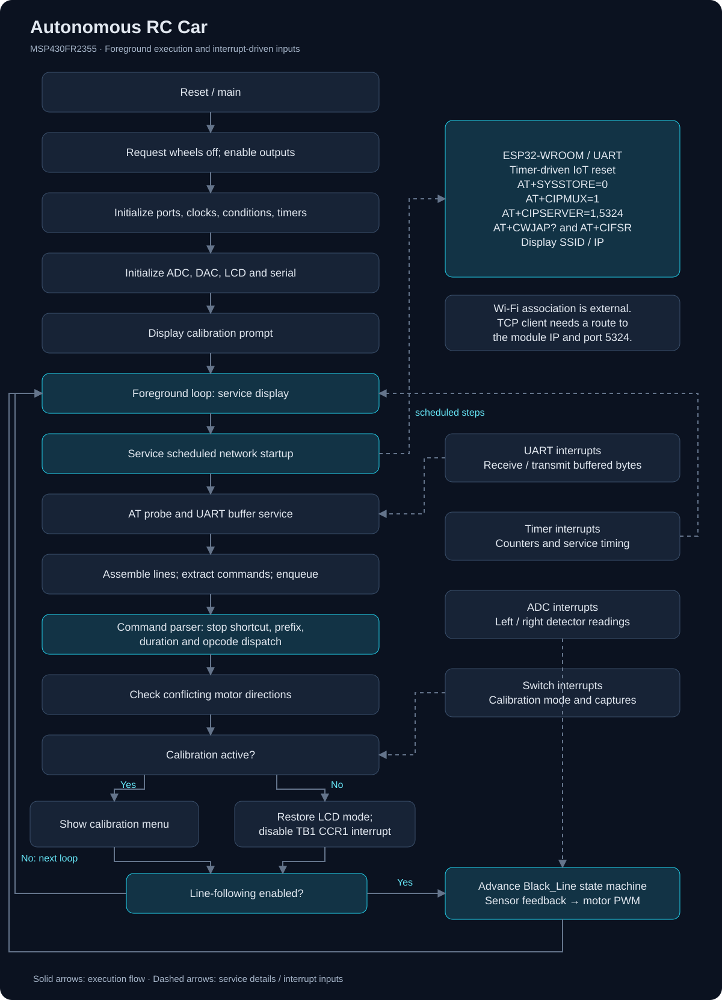

# IoT-enabled-autonomous-RC-car-governed-by-TI-MSP430

My MSP430FR2355 RC car project combines reflectance sensing, differential motor control, interrupt-driven serial communication, and a timer-based navigation state machine. I developed this vehicle as a comprehensive embedded robotics project, from application firmware and PCB population to physical assembly and calibration. Coordinating wireless control with autonomous navigation required managing incoming commands, sensor feedback, and timed motor actions on the MSP430FR2355. Working across firmware and hardware meant understanding how a decision in the code became a physical response, then tracing that response back through the control logic, peripheral configuration, and assembled electronics.

**Platform:** TI MSP430FR2355 · **Language:** C · **Environment:** Code Composer Studio

## What The Firmware Accomplishes

- Samples left and right infrared detector signals through the ADC.
- Drives forward, reverse, and pivots based on Timer B PWM registers.
- Uses serial receive/transmit buffers and command queues to process remote motion commands.
- Sends AT commands to an IoT module to configure a TCP server and obtain connection information.
- Provides an LCD interface for calibration, connection information, and navigation status.
- Searches for a black line, aligns the vehicle, follows the line, and enters a line-following phase.

I organized the control logic around threshold-based sensor feedback and timer-driven state machines.

## Hardware and physical assembly

I assembled the vehicle using a stacked PCB assembly and a wooden chassis:

- **MSP430FR2355 controller PCB:** Runs the sensing, command parsing/execution, timing, and motor-control firmware.
- **ESP32-WROOM module:** Connects to the MSP430 over UART and provides the vehicle's Wi-Fi / IoT connectivity. I mounted the ESP32-WROOM through a connector; the MSP430 exchanges AT commands as well as serial data with it.
- **LCD PCB:** I soldered an LCD onto a PCB that stacks on top of the MSP430 controller PCB. The display presents calibration prompts, connection information, and vehicle status.
- **MOSFET motor-control board:** Sits beneath the MSP430 board and controls the motors in response to the controller's drive signals.
- **Wooden frame:** Supports the assembled PCB stack, with the motors and wheels affixed to the frame.

## Firmware execution flow

The foreground loop repeatedly services work; interrupts update shared state. See the [architecture notes](docs/ARCHITECTURE.md) for the full network startup, TCP command path, and navigation sequence. The ESP32-WROOM handles Wi-Fi connectivity. After network association, the MSP430 configures the TCP server and queries the module for its SSID and IP address.

## Explore the code

| Area | File | Responsibility |
| --- | --- | --- |
| Orchestration | `src/main.c` | Initialization and foreground service loop |
| Navigation | `src/motion.c` | Motor primitives, line acquisition and traversal |
| Serial communication | `src/CerealPort.c` | UART initialization and interrupts, receive/transmit buffers, command extraction and queues |
| Command handling | `src/command.c` | AT startup sequence, SSID/IP reply processing, command prefix checks and motion dispatch |
| Timing | `src/timerz.c` | Timer setup and interrupt handlers |
| Sensing | `src/adc.c` | ADC channel sequencing and detector readings |
| Display | `src/display.c` | LCD updates, status screens and calibration menus |
| Switch input | `src/switches.c` | Switch interrupts, debounce initiation and calibration input |
| GPIO | `src/ports.c` | Pin directions, peripheral selection and initial port configuration |
| Analog output | `src/DAC.c` | SAC/DAC initialization and initial output target |
| Initial conditions | `src/init.c` | Display buffer initialization and interrupt enable call |
| System support | `src/system.c` | Global interrupt enable routine |
| LED support | `src/led.c` | LED initialization |
| Clock support | `src/clocks.c` | Configures XT1 as the ACLK/FLL reference, selects the 8 MHz DCO range for MCLK/SMCLK, and runs software frequency trim |
| Interfaces | `include/` | Project headers and hardware definitions |
| Linker | `platform/lnk_msp430fr2355.cmd` | TI device memory map, original license retained |

## Authorship and attribution

I built and assembled this autonomous RC car around a pre-populated TI MSP430FR2355 board. My professor at the time, Jim Carlson designed the schematics and layouts for the other printed circuit boards. However, I populated the components onto the PCBs and developed the vehicle's firmware. For further insight, component credits are listed in [Attribution](docs/ATTRIBUTION.md).

## Setup and reproduction

The archived project configuration specifies **Code Composer Studio 12.8.0** and **TI MSP430 compiler 21.6.1.LTS**.

1. Install Code Composer Studio with MSP430 support and compiler 21.6.1.LTS from TI.
2. Create an MSP430FR2355 C project. Add the `src/` sources and `include/` search path. Use the linker file in `platform/`, avoiding a duplicate auto-generated device linker file.
3. Match the board wiring to `include/ports.h`; confirm the MOSFET motor-control board, detector circuits, LCD model, ESP32-WROOM UART and power system connections. 
4. Build the project and resolve compiler/linker diagnostics.
5. With wheels raised, verify stop behavior, motor directions, detector readings, calibration, UART settings, and timer behavior before a floor test. 

## Repository layout

I grouped C source files in `src/`, project headers in `include/`, and the device linker script in `platform/`. Generated build outputs and local IDE settings are excluded.

The command parser checks the four-character prefix defined in `src/command.c`; the uppercase `S` stop shortcut is handled before that check.

## License and dependencies

The TI linker script retains its original redistribution notice. See [License](LICENSE.md) and [Attribution](docs/ATTRIBUTION.md) for licensing scope and external dependencies.