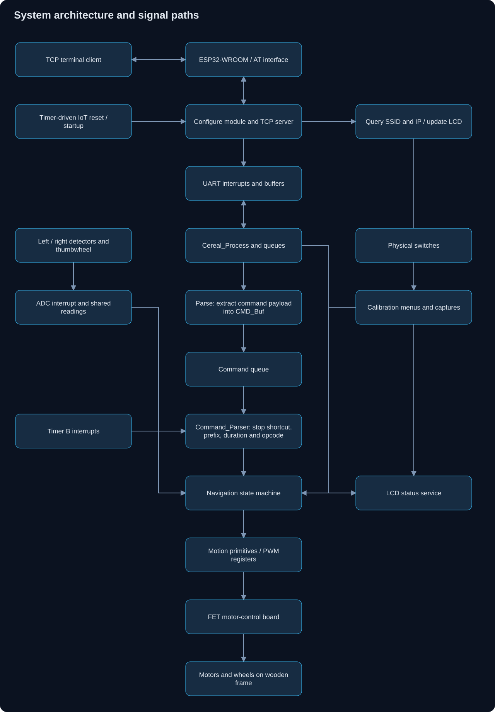
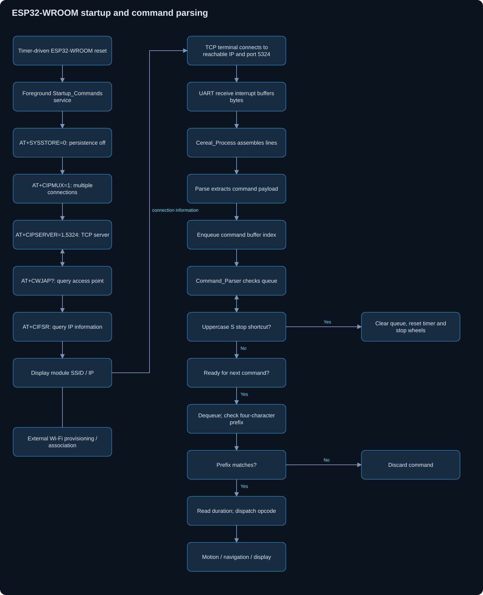
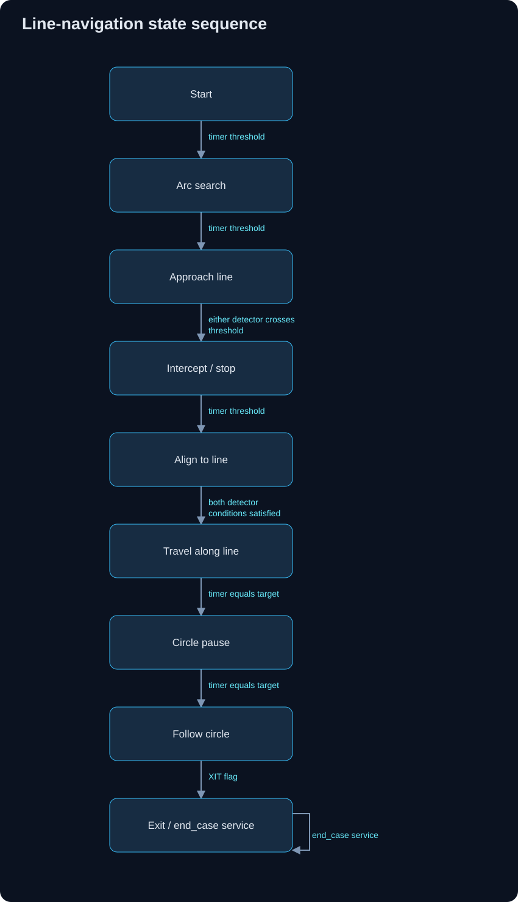

# Architecture

I split the vehicle into sensing, communication, navigation, motor control, and display services.

## Hardware arrangement

I connected an **ESP32-WROOM** to the **MSP430FR2355 over UART** and mounted the module through a connector. The ESP32-WROOM supplies Wi-Fi / IoT connectivity and the MSP430 runs the vehicle-control firmware.

I soldered the system's LCD onto a PCB that stacks onto the MSP430 PCB. I placed a FET motor-control board below the MSP430 PCB and mounted the complete PCB stack on a wooden frame, with the motors and wheels affixed to that frame. 

Logical signal path: **network client → ESP32-WROOM → UART → MSP430 → FET motor-control board → motors and wheels**. The LCD provides a local status interface.

## Network startup and command path

I use timer-scheduled AT commands to configure the ESP32-WROOM's TCP server and request its SSID and IP information. Wi-Fi association is handled by the module's network configuration. A terminal then connects to the module's reachable IP address on port **5324**.

UART interrupts buffer incoming bytes. `Cereal_Process()` assembles lines, `Parse()` extracts command payloads, and `Command_Parser()` dispatches queued commands. `PING()` sends an AT responsiveness probe to the module.

The command parser uses the four-character prefix defined in `src/command.c`. The parser's uppercase `S` stop shortcut precedes the prefix check. The prefix is not secure authentication.

## Line-navigation sequence

`Black_Line()` uses numbered states 0 through 8. `traversal()` compares the two readings against `GRAY` and selects forward, pivot, or asymmetric reverse movement. Some acquisition states use a fixed detector threshold rather than `GRAY`.

The exit command clears the foreground line-following enable flag and sets `XIT`. The state machine also contains an `end_case()` exit routine. Timer counters govern transitions between navigation stages.
